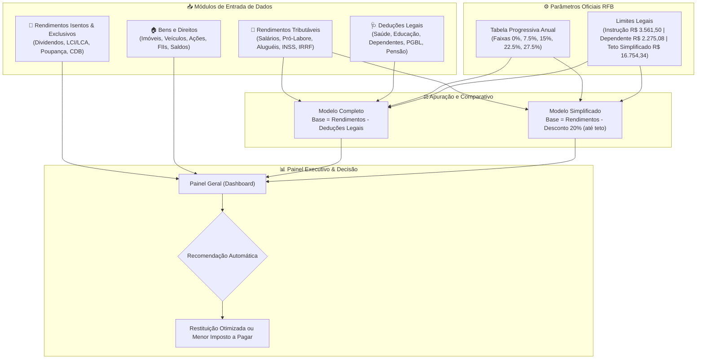

# 🏛️ Organizador e Simulador de Declaração de Imposto de Renda (IRPF) no Excel


Solução profissional e agregadora de dados desenvolvida em **Microsoft Excel** com motor complementar em **Python** para centralizar, auditar, classificar e simular a **Declaração de Ajuste Anual do Imposto sobre a Renda da Pessoa Física (DIRPF)** de acordo com a legislação e parâmetros vigentes da Receita Federal do Brasil (RFB).

---

## 🎯 Visão Geral do Projeto

A preparação da declaração de imposto de renda anual frequentemente resulta em erros, retrabalho ou envio pelo regime tributário menos vantajoso (pagando mais imposto ou recebendo menor restituição). 

Este projeto resolve esse problema através de:
1. **Pasta de Trabalho Inteligente (`Organizador_Declaracao_IRPF.xlsx`)**: Estrutura contábil em abas temáticas interligadas com links rápidos de navegação, fórmulas automatizadas (`SOMA`, `SE`, `MÍNIMO`, `MÁXIMO`), formatação condicional executiva e comparativo em tempo real entre o **Modelo Completo (Deduções Legais)** e o **Modelo Simplificado (Desconto Padrão de 20%)**.
2. **Motor Fiscal em Python (`simulador_irpf.py`)**: Script CLI para processamento por linha de comando, conferência de faixas da tabela progressiva, cálculo de alíquotas efetivas, exportação para CSV/JSON e testes unitários automatizados.

---

## 🏗️ Arquitetura e Fluxo de Dados

O fluxo operacional do organizador centraliza as fontes pagadoras, deduções e movimentação patrimonial, conduzindo os dados ao painel de apuração:



---

## 📑 Estrutura da Pasta de Trabalho Excel

A planilha foi elaborada seguindo princípios profissionais de modelagem financeira, separando premissas, bases de dados e relatórios finais:

| Aba | Descrição e Finalidade | Principais Fórmulas & Recursos |
| :--- | :--- | :--- |
| **`Painel Geral`** | Dashboard consolidado, atalhos de navegação para todas as abas, KPIs de rendimentos e IRRF retido, e matriz comparativa completa vs simplificada. | `=SE()`, `=MÍNIMO()`, `=MÁXIMO()`, `=SUM()`, Hiperlinks, Formatação Condicional de resultado. |
| **`Rendimentos Tributáveis`** | Cadastro detalhado de todas as fontes pagadoras (CNPJ/CPF), proventos brutos, contribuição previdenciária oficial (INSS), IRRF retido e 13º salário. | `=SUM(E4:E19)`, formatação monetária automática e linhas zebradas para auditoria visual. |
| **`Rendimentos Isentos`** | Registro de rendimentos isentos, não tributáveis ou sujeitos à tributação exclusiva (dividendos, LCI/LCA, rendimento de poupança, CDBs com IR retido). | Código de lançamento oficial da RFB, identificação de fonte pagadora e totalizadores. |
| **`Deduções Legais`** | Controle individualizado de despesas dedutíveis: médicos/hospitais (sem teto), instrução (com teto legal), dependentes (valor fixo anual) e PGBL (teto 12%). | Aplicação de tetos normativos automáticos via `=MIN()`, vinculados à aba de Regras Fiscais. |
| **`Bens e Direitos`** | Mapeamento do patrimônio do contribuinte (imóveis, veículos, investimentos e contas bancárias), registrando saldo anterior, saldo atual e variação percentual. | Cálculo de variação anual em R$ e %, controle patrimonial essencial contra malha fina. |
| **`Regras Fiscais`** | Tabela paramétrica oficial contendo faixas salariais, alíquotas nominais, parcelas a deduzir e limites legais atualizados. | Referenciamento centralizado que permite atualização anual de parâmetros sem quebrar fórmulas. |

---

## 🧮 Regras e Parâmetros Fiscais Aplicados

As apurações seguem a legislação tributária brasileira em vigor:

### 1. Tabela Progressiva Anual de IRPF
- **Até R$ 27.110,40**: Alíquota **0,0%** (Isento) | Parcela a Deduzir: **R$ 0,00**
- **De R$ 27.110,41 a R$ 33.919,80**: Alíquota **7,5%** | Parcela a Deduzir: **R$ 2.033,28**
- **De R$ 33.919,81 a R$ 45.012,60**: Alíquota **15,0%** | Parcela a Deduzir: **R$ 4.577,27**
- **De R$ 45.012,61 a R$ 55.976,16**: Alíquota **22,5%** | Parcela a Deduzir: **R$ 7.953,21**
- **Acima de R$ 55.976,16**: Alíquota **27,5%** | Parcela a Deduzir: **R$ 10.752,02**

### 2. Deduções e Limites Legais
- **Desconto Simplificado**: **20%** sobre os rendimentos tributáveis brutos, limitado ao teto legal de **R$ 16.754,34**.
- **Dedução por Dependente**: **R$ 2.275,08** anuais por dependente legal informado.
- **Despesas com Instrução / Educação**: Limite individual anual de **R$ 3.561,50** por beneficiário (titular ou dependente).
- **Despesas Médicas**: Dedutíveis **integralmente** (100%), sem limite de teto, mediante comprovação idônea (notas fiscais/recibos).
- **Previdência Complementar (PGBL)**: Dedutível até o limite de **12%** do total de rendimentos tributáveis brutos.

---

## 💻 Simulador CLI em Python

Além da pasta de trabalho em Excel, o projeto inclui um simulador completo em linha de comando (`simulador_irpf.py`) para conferência contábil e auditoria automatizada:

### Execução Padrão
```bash
python simulador_irpf.py
```

### Exemplo de Saída no Terminal
```text
==============================================================================
ORGANIZADOR E SIMULADOR DE IMPOSTO DE RENDA (IRPF)
Autor: Wendel Vieira | Base Normativa: RFB
==============================================================================
Rendimentos Tributaveis Brutos : R$ 169.000,00
Previdencia Oficial (INSS)     : R$ 15.160,00
IRRF Retido na Fonte           : R$ 18.150,00
------------------------------------------------------------------------------
Item de Comparacao                  | Deducoes Legais    | Simplificado      
------------------------------------------------------------------------------
Deducoes / Desconto Padrao          | R$ 40.108,08       | R$ 16.754,34      
Base de Calculo do IRPF             | R$ 128.891,92      | R$ 152.245,66     
Imposto Anual Devido                | R$ 24.693,26       | R$ 31.115,54      
Aliquota Efetiva (%)                | 14.61 %            | 18.41 %           
IRRF Ja Retido                      | R$ 18.150,00       | R$ 18.150,00      
------------------------------------------------------------------------------
SALDO FINAL APURADO                 | A Pagar: R$ 6.543,26 | A Pagar: R$ 12.965,54
==============================================================================
RECOMENDACAO: Deducoes Legais (Modelo Completo)
Vantagem Economica Estimada: R$ 6.422,28
==============================================================================
```

### Parâmetros Personalizados e Exportação
```bash
# Simulação personalizada com exportação em CSV
python simulador_irpf.py --rendimentos 120000 --inss 11000 --irrf 14000 --saude 8500 --dependentes 2 --export-csv resultado.csv

# Saída estruturada em JSON (ideal para integrações de API)
python simulador_irpf.py --json
```

---

## 🧪 Testes Unitários

O projeto possui cobertura de testes automatizados via `unittest` para assegurar que as regras de alíquotas, faixas e limites legais sejam estritamente obedecidas:

```bash
python -m unittest test_simulador_irpf.py
```

```text
......
----------------------------------------------------------------------
Ran 6 tests in 0.001s

OK
```

---

## 👤 Autor

Desenvolvido por **Wendel Vieira**.  
Desafio de Projeto DIO & Reclame AQUI: *Criando Um Organizador de Declaração de Imposto de Renda*.
